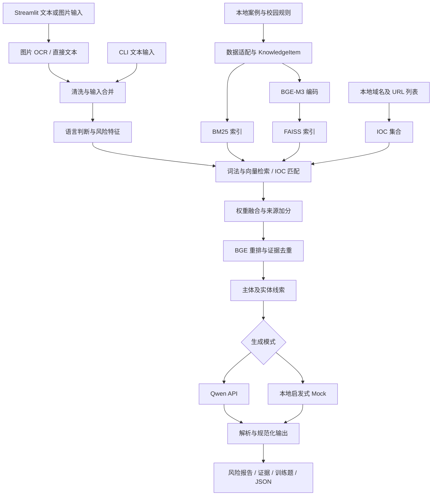

# 校园反诈媒体识别与训练系统：项目完整分析报告

> 分析日期：2026 年 10 月 22 日  
> 项目目录：`C:\Users\22672\Desktop\N&D_Coursework`  
> 产品名称：Campus Anti-Fraud RAG System / Anti-Fraud Coach  
> 分析依据：当前源代码、配置、持久化索引、已有运行产物、课程报告和本次验证。

## 目录

1. [项目概述](#1-项目概述)
2. [项目组成与目录](#2-项目组成与目录)
3. [技术栈与依赖](#3-技术栈与依赖)
4. [系统架构与数据流](#4-系统架构与数据流)
5. [核心技术原理](#5-核心技术原理)
6. [功能及实现状态](#6-功能及实现状态)
7. [数据、模型及其他资源](#7-数据模型及其他资源)
8. [输出结构与接口边界](#8-输出结构与接口边界)
9. [部署与使用](#9-部署与使用)
10. [测试、结果与证据边界](#10-测试结果与证据边界)
11. [应用领域与适用条件](#11-应用领域与适用条件)
12. [工程问题与改进建议](#12-工程问题与改进建议)
13. [总体评价](#13-总体评价)
14. [证据索引](#14-证据索引)

## 1. 项目概述

本项目面向大学生、教师及课程评审人员，围绕可疑短信、聊天记录、邮件、社交媒体文案、URL 描述和截图中的文字，提供诈骗风险识别、证据解释、防范建议及训练题生成。其核心是一个结合规则特征、混合检索和大语言模型生成的 RAG 原型。

系统使用本地知识库提供案例与规则证据，通过 Qwen 的 DashScope 兼容接口生成可读报告；没有密钥、主动启用 Mock 或 API 调用异常时，可使用本地启发式分析继续输出结构化结果。

### 1.1 项目的实际定位

- **已实现的主要程序**：Python 核心引擎、Streamlit Web 应用、命令行演示和离线索引构建。
- **独立界面原型**：`webdesign/` 中的 React 应用使用固定模拟结果，尚未与 Python 引擎建立真实调用链。
- **处理对象**：文字及经 OCR 转换的图片文字。没有发现音频识别、视频分析或直接理解图片语义的视觉大模型链路。
- **训练含义**：面向用户生成反诈练习题，不是训练或微调 BGE/Qwen 模型。项目未包含模型训练循环、优化器或微调数据管线。
- **成熟度**：具备课程展示和功能原型基础；尚不足以依据现有证据宣称为经过大规模验证的生产级反诈平台。

### 1.2 主要价值

系统把“识别风险—查看证据—理解原因—采取行动—练习巩固”组织成连续流程。相比单一关键词匹配，增加语义检索与模型生成；相比直接调用大模型，保留特征、来源和检索分数，便于解释与课程实验复查。

## 2. 项目组成与目录

```text
N&D_Coursework/
├── app.py                       Streamlit 主应用
├── build_index.py               离线知识库与索引构建入口
├── run_demo.py                  CLI 分析入口
├── anti_fraud_rag/              核心业务与算法模块
│   ├── config.py                环境配置
│   ├── schemas.py               KnowledgeItem、IocStore
│   ├── data_loader.py           数据集适配与 IOC 导入
│   ├── preprocessing.py         文本清洗与 OCR 输入合并
│   ├── risk_features.py         双语风险规则及特征评分
│   ├── entity_extraction.py     联系方式、主体及角色线索
│   ├── ocr.py                   PaddleOCR 适配
│   ├── retriever.py             BM25、BGE-M3、FAISS、融合与去重
│   ├── reranker.py              BGE CrossEncoder 重排
│   ├── qwen_client.py           DashScope API 客户端
│   ├── rag_engine.py            分析编排、提示词、结果规范化
│   └── utils.py                 语言判断、URL 提取等工具
├── storage/rag_index/           已生成的知识与检索索引
├── tests/test_core.py           14 个核心行为测试
├── webdesign/                  React + TypeScript 界面原型
│   ├── src/views/               六类页面
│   ├── src/mockData.ts          固定展示数据
│   ├── src/types.ts             前端类型定义
│   └── dist/                   已有前端构建产物
├── scripts/                    draw.io 架构图生成脚本
├── outputs/                    演示 JSON、截图、架构图、日志
├── 参考文献/                   五份论文 PDF
├── downloads/                  draw.io 安装包及便携程序
├── N&D Report.docx             英文课程报告
├── code.zip                    仅包含 app.py 的压缩包
├── README.md                   使用与技术说明
├── PRODUCT.md                  产品定位与设计原则
├── requirements.txt            Python 依赖约束
└── .env.example                环境配置模板
```

`downloads/` 是文档制作工具资源，不属于业务服务；`__pycache__/` 是运行缓存。外部模型和原始数据主要存放在 D 盘，不在本项目目录内。`code.zip` 不是完整项目交付包，单独解压无法还原整个系统。

## 3. 技术栈与依赖

### 3.1 Python 主系统

| 层次 | 技术 | 实际用途 |
|---|---|---|
| 编程语言 | Python | 数据加载、检索、OCR、LLM 编排与页面逻辑 |
| 应用界面 | Streamlit | 页面导航、输入、结果、证据、历史及 JSON 下载 |
| 语义编码 | Sentence Transformers + BGE-M3 | 将查询与知识条目转为归一化稠密向量 |
| 张量运行时 | PyTorch | BGE 编码与重排模型计算，自动选择 CPU/CUDA |
| 向量搜索 | FAISS `IndexFlatIP` | 对归一化向量执行精确内积检索 |
| 词法检索 | 自实现 BM25 + jieba | 英文正则分词与中文分词后的词项匹配 |
| 重排 | CrossEncoder + bge-reranker-v2-m3 | 计算查询与证据段落的相关性 |
| 图像文字 | PaddleOCR + PaddlePaddle | 将截图文字转换为统一分析文本 |
| 模型服务 | OpenAI Python SDK | 调用 DashScope 的兼容 Chat Completions 接口 |
| 配置 | python-dotenv + dataclass | 环境变量、模型目录、权重及功能开关 |
| 存储 | JSONL、JSON、TXT、joblib、FAISS 文件 | 本地知识、配置、IOC 和索引持久化 |
| 数值与展示 | NumPy、pandas 等 | 分数计算、表格及辅助处理 |

`requirements.txt` 还声明 Pillow、scikit-learn、SciPy、chardet 等依赖。依赖清单不等于每个库都构成核心算法；例如 BM25 是项目自身实现，没有调用 scikit-learn 的分类器。PyTorch 在代码中直接导入，但没有在该文件中独立锁定版本。

本次读取 `D:\conda\envs\pytorch` 的安装元数据得到：

| 组件 | 当前该环境版本 |
|---|---|
| Python | 3.12.9 |
| PyTorch | 2.4.1 |
| transformers | 4.44.2 |
| sentence-transformers | 5.5.1 |
| Streamlit | 1.58.0 |
| faiss-cpu | 1.14.2 |
| PaddleOCR / PaddlePaddle | 3.7.0 / 3.2.2 |
| OpenAI SDK | 2.41.1 |

以上是特定本机环境的安装版本，不能替代跨机器兼容性验证。`faiss-cpu` 表明向量索引使用 CPU 版本；BGE 编码选择 CUDA 并不意味着 FAISS 搜索也在 GPU 上运行。

### 3.2 React 界面原型

主要依赖声明为 React 19、TypeScript 5.8、Vite 6、Tailwind CSS 4、Lucide React 图标及 Motion 动画。`pnpm-lock.yaml` 提供前端锁文件。

界面使用 Inter、Playfair Display、JetBrains Mono 字体，并通过 Google Fonts CSS 地址引用，因此字体展示涉及外部网络资源。未加载时可落回系统字体。

`@google/genai`、Express 和 Gemini 相关模板说明存在于依赖或 README 中，但当前 `src/` 没有发现 Gemini 模型调用、真实分析网络请求或 Express 服务实现，不能据此认定项目采用了 Gemini 作为业务推理模型。

## 4. 系统架构与数据流

### 4.1 架构类型

Python 部分是**模块化单体应用 + 本地文件索引 + 外部模型 API**。Streamlit 直接调用 Python 引擎，未发现独立 REST API 服务、数据库服务、任务队列或微服务间通信。



React 原型是另一条独立展示链：`mockData.ts → App.tsx → 六个视图`，当前没有连接到上图中的真实分析链路。

### 4.2 离线构建阶段

1. 从配置的数据根目录读取五类知识来源及三类 IOC 来源。
2. 将异构 CSV/JSONL 内容转换为统一 `KnowledgeItem`。
3. 使用标题、来源、语言、类别、风险等级和正文拼接检索文档。
4. 构建所有知识条目的 BM25 索引。
5. 按配置对全部或部分条目生成归一化向量，建立 FAISS 内积索引。
6. 保存知识、索引、向量位置映射、IOC 集合和构建清单。

默认每个普通案例来源最多读取 1,200 条；校园规则单独加载。IOC 的默认读取上限参数为每来源文件 200,000，但 URL 文件还会贡献域名，因此总域名数量不受单个 200,000 限制。

### 4.3 在线推理阶段

文本及截图 OCR 结果先合并，再执行语言判断、规则特征提取、IOC 精确匹配和混合检索。检索证据确定后，实体模块补充输入主体及证据标题/来源线索；随后调用 Qwen 或本地 Mock，并规范化返回字段。

Streamlit 使用 `st.cache_resource` 缓存引擎和 OCR 对象。BGE 与重排模型采用延迟加载。图片先写入临时文件，OCR 完成后通过 `finally` 清理；原始图片不是发送给 Qwen 的输入，OCR 文字则可能进入远程模型提示词。

## 5. 核心技术原理

### 5.1 文本清洗与语言判断

预处理移除部分控制字符、压缩空白，并可记录文字来源、清理数量等信息。图片文本合并时加入文件来源标记。

语言检测先剔除网络地址，再统计汉字与英文字母，返回 `zh / en / mixed / unknown`。这是轻量规则判断，不是训练得到的语言识别模型；含少量英文标记的中文内容也可能归为 mixed。

### 5.2 风险特征与实体抽取

规则特征包含九类：验证码/凭据索取、金融信息、预付费、紧迫感、身份冒充、招聘实习、校园情境、退款奖励、投资贷款。

| 类别 | 权重 |
|---|---:|
| credential_request | 0.18 |
| financial_info | 0.16 |
| upfront_payment | 0.16 |
| urgency_pressure | 0.12 |
| impersonation | 0.12 |
| job_or_internship | 0.08 |
| campus_context | 0.06 |
| refund_or_reward | 0.06 |
| investment_or_loan | 0.06 |

每个类别命中后累计一次权重；检测到 URL/域名、电话号码、金额时分别增加 0.12、0.06、0.08，最终截断至 1。类别内部主要使用字符串包含关系，因此容易解释，但不能准确处理否定、引用、反诈宣传语等复杂语境。

实体模块使用正则与词表提取 URL、域名、邮箱、电话、金额、组织和发件人角色线索。它不是通用命名实体识别模型，也没有执行真实身份认证。证据中的标题与来源会进入 `evidence_subjects`，应与原始输入真正提及的主体区分。

### 5.3 BM25 与稠密检索

BM25 默认 `k1=1.5`、`b=0.75`。英文通过正则分词，中文通过 jieba 分词并过滤长度不大于 1 的词。查询词去重后，对每份文档计算词项频率、逆文档频率和长度归一化得分。

BGE-M3 由 SentenceTransformer 加载，默认批大小 8、最大序列长度 512。编码时启用 `normalize_embeddings=True`，然后以 `IndexFlatIP` 建索引；归一化向量的内积用于相似度排序。项目使用 BGE-M3 的稠密向量能力，未实现该模型其他稀疏或多向量检索路径。

语义检索数量为 `min(max(top_k × 8, 30), dense_items)`。BM25 和稠密分数分别执行 min-max 归一化，所有值相同时返回全零。

### 5.4 IOC 匹配与融合

IOC 是 Indicator of Compromise，此处具体指本地可疑域名与 URL 指标。系统对规范化字符串进行集合精确匹配，不主动访问输入网址，也不进行实时网页抓取、证书检查或 DNS 风险查询。未命中本地名单不表示网址安全。

实际融合公式为：

```text
S_fusion = 0.35 × BM25_norm
         + 0.35 × Dense_norm
         + 0.15 × URL_component
         + 0.15 × Risk_component
         + Source_boost

Source_boost = 0.07（campus_rules）+ 0.04（High 标签）
```

这比 README 和课程报告中的四项公式多了固定加分，复现实验时不能忽略。

`URL_component` 的含义也需准确理解：一旦输入出现 IOC 命中，系统按知识条目的钓鱼/链接关键词、来源及风险标签分配加分；它不是“每条证据都命中了该 URL”的逐条同址证明。

`Risk_component` 综合输入命中词在知识条目中的出现次数、风险类别对齐程度、输入风险分数及条目 High 标签。因此检索具有主动偏向校园规则和高风险案例的设计，需要通过正常文本测试评估误报影响。

### 5.5 重排与去重

候选池大小为：

```text
min(max(top_k × 4, reranker_top_n, top_k), knowledge_items)
```

默认 `reranker_top_n=12` 是候选数量下限之一，不是固定最多重排 12 条。默认 `top_k=6` 时，候选数为 24。

CrossEncoder 对查询与候选证据成对评分；不在 [0,1] 内的输出经 sigmoid 变换。候选最终分数为：

```text
S_candidate = 0.70 × normalize(S_fusion_candidates)
            + 0.30 × S_cross_encoder
```

随后按 ID 和规范化标题/正文指纹去重，重新编号并截取 top-k。指纹会替换 URL、数字并截取前 500 字符，可压缩近似重复证据，也可能合并仅网址或数字不同但实际独立的案例。

当前实现会把重排后的候选分数写回全体条目的数组，未进入重排的条目保留原融合分数，再进行全局排序。两种分数不完全同尺度，可能影响最终排名；正式实验宜限定最终排序范围或统一评分口径。

### 5.6 Qwen 生成与本地降级

代码默认模型字符串为 `qwen3.7-plus`，默认端点是 DashScope 兼容接口，超时配置 30 秒，temperature 为 0.1。模型名称及服务可用性属于配置事实，本次没有发起外部 API 请求验证。

提示词包含输入、语言、预处理、特征、实体、IOC 命中、融合配置和检索证据，要求返回 JSON。支持纯 JSON、代码块 JSON 和嵌入对象提取，之后通过 `ensure_analysis_schema` 补充缺失字段。

本地 Mock 的风险分数为：

```text
risk_score = min(0.68 × risk_keyword_score
                 + 0.24 × 是否命中IOC
                 + 0.08 × 前三条证据是否包含High或校园规则, 1)
```

启发式分级阈值为 High ≥ 0.70、Medium ≥ 0.35、其余 Low。这不是经统计校准的诈骗概率。真实 API 返回有效风险等级时，代码优先保留该等级，不一定依据分数重算，所以等级与分数一致性仍需检查。

Mock 使用固定英文报告模板和通用训练问题；双语输入支持不能等同于所有降级输出均完成了双语生成。API 异常会加入 `api_error` 并设置 `raw_model_output=api_error_fallback`。

## 6. 功能及实现状态

| 功能 | Streamlit/Python | React 原型 | 边界 |
|---|---|---|---|
| 文本输入与分析 | 已接入引擎 | 可编辑输入框，结果固定 | React 分析按钮无真实调用 |
| 图片上传与 OCR | 已接入 PaddleOCR | 上传外观展示 | 图片语义依赖识别出的文字 |
| 中英文及混合输入 | 已实现规则判断与提示策略 | 中文界面为主 | Mock 文字仍主要为英文 |
| 风险等级、类型与信号 | 引擎生成并展示 | mockResult 展示 | 分数不是已校准概率 |
| 检索与证据详情 | 展示真实检索条目及评分 | 固定示例证据 | 真实检索可因模型错误退化 |
| 反诈建议与安全改写 | Qwen 生成或默认模板 | 固定示例 | 无正式质量评测 |
| 训练题 | 题目、选项展示、参考答案 | 固定题目与选择反馈 | 无持续学习档案 |
| 历史记录 | 当前会话最近 25 条，可检索/回看 | mockHistory | 无数据库持久化 |
| JSON 调试 | 展示、下载完整结果 | 模拟 JSON 展示 | 两套字段定义不同 |
| CLI 演示 | 中、英、混合示例和自定义文本 | 不适用 | CLI 不直接提供图片参数 |
| 用户账户和权限 | 未发现 | 未发现 | 尚无多用户业务隔离设计 |
| 模型训练/微调 | 未发现 | 未发现 | “训练中心”是反诈教育功能 |

Streamlit 的训练页允许选择选项和显示参考答案，但没有发现自动判分、学习进度持久化、错题管理或个性化推荐。React 中虽有选项反馈，仍基于固定模拟题。

`PRODUCT.md` 提出 WCAG AA 对比度、不仅依赖颜色、移动端双语等目标；这些是设计要求，不能视为已完成的无障碍测试结论。

## 7. 数据、模型及其他资源

### 7.1 实际入库知识规模

本次逐行统计 `storage/rag_index/items.jsonl`，结果与 manifest 一致：

| 来源标识 | 数据目录或资源 | 条数 | 用途 |
|---|---|---:|---|
| campus_rules | campus_anti_fraud_bilingual_rules | 50 | 校园双语规则、场景与建议 |
| ChiFraud | ChiFraud | 1,200 | 中文案例与原始类别 |
| sms_mms | hf_notd5a_malicious-benign-sms-mms-dataset | 1,200 | 恶意/正常短信案例 |
| discord_phishing | hf_wangyuancheng_discord-phishing-scam-clean | 1,200 | 社交平台钓鱼案例 |
| email_safety_triage | hf_weijianzhg_email-safety-triage-10k | 1,200 | 邮件安全案例 |
| **合计** | | **4,850** | 全部进入当前稠密索引 |

语言标签为英文 3,600、中文 1,200、混合 50；风险标签为 High 2,249、Medium 866、Low 1,735。标签由各加载器转换，并非统一人工复核标注。例如邮件加载器将未包含指定高风险词的标签映射为 Medium，ChiFraud 将非 0 类映射为 High。

不同来源的标签语义不完全一致；部分中文类别描述违法或不当内容，并不天然等同于“面向学生的诈骗”。数据适用性需要结合具体任务重新审查。

### 7.2 IOC 资源

加载器使用以下目录中的指标：

- `github_Phishing-Database_Phishing.Database`：活动域名与链接文件。
- `hf_phishdestroy_destroylist`：`domains.csv`。
- `github_scamsniffer_scam-database`：`blacklist/domains.json`。

本次统计持久化文件得到 **659,034 个域名行**、**198,017 个 URL 行**。这些是当前快照规模，不是实时活跃威胁数量；没有在索引中记录各指标最后核验时间或逐条来源。

外部数据根目录还有其他数据集，但 `load_knowledge_corpus` 并未加载它们。不能把“磁盘上有的数据集”都列为本系统已使用的数据。

### 7.3 索引资源占用

| 文件 | 本次读取字节数 | 内容 |
|---|---:|---|
| bm25.joblib | 2,709,126 | BM25 统计对象 |
| faiss_bge_m3.index | 19,865,645 | 稠密向量索引 |
| dense_item_indices.json | 27,990 | 向量与知识条目映射 |
| items.jsonl | 2,919,662 | 知识正文与元数据 |
| ioc_domains.txt | 19,704,609 | 规范化域名集合 |
| ioc_urls.txt | 18,208,442 | 规范化 URL 集合 |
| manifest.json | 691 | 构建配置摘要 |

这些文件合计约 60.5 MiB，不含模型权重、原始数据、Python 环境与文档制作工具。运行时还要加载 Python 字符串集合、模型参数及中间张量，磁盘索引大小不能直接代表内存或显存需求。

### 7.4 模型与计算资源

| 资源 | 默认路径/配置 | 作用 |
|---|---|---|
| BGE-M3 | `D:\CARIC模型&数据集\models\BAAI_bge-m3` | 多语言稠密编码 |
| BGE 重排模型 | `D:\CARIC模型&数据集\models\BAAI_bge-reranker-v2-m3` | 证据重排 |
| PaddleOCR | `D:\CARIC模型&数据集\models\PaddleOCR` | 图片文字识别 |
| Qwen | `QWEN_MODEL=qwen3.7-plus` | 远程分析报告生成 |
| 原始数据 | `D:\CARIC模型&数据集\datasets` | 离线重建知识索引 |

本次确认上述本地目录存在，未对全部权重文件校验哈希。manifest 记录构建时 BGE 设备为 CUDA；课程报告记录 RTX 4060 Laptop GPU/CUDA 11.8，此处作为既有报告信息，不等同于本次重新完成硬件运行验证。

OCR 适配器尝试新旧 PaddleOCR 参数及结果结构，包含 PP-OCRv5 mobile 检测/识别目录及旧版方向模型目录。不过第一次初始化尝试仅指定语言与功能开关，没有显式绑定本地模型目录；不能保证所有运行均强制离线。

### 7.5 学术与文档资源

本次读取五份本地论文 PDF 的首页，确认其主题及与项目的对应关系：

| 本地文件 | 页数 | 对应技术/背景 |
|---|---:|---|
| M3-Embedding.pdf | 18 | 多语言文本嵌入 |
| Retrieval-augmented-generation-for-knowledge-intensive-nlp-tasks.pdf | 16 | RAG 技术基础 |
| PASSAGE RE-RANKING WITH BERT.pdf | 5 | 查询—段落交叉编码重排思想 |
| The Probabilistic Relevance Framework-BM25 and Beyond.pdf | 59 | BM25 概率相关性框架 |
| A Quantitative Study of SMS Phishing Detection.pdf | 15 | 短信钓鱼识别及用户教育背景 |

这是参考材料清点与主题核验，不是对论文全部结论的复现。BERT 重排论文提供方法背景，代码实际加载的是 BGE 重排模型。

`N&D Report.docx` 是完整英文课程报告，包含架构、公式、运行环境、初步结果及参考文献。`outputs/` 保存架构图的 draw.io、SVG、PNG、PDF 版本、运行截图和 CLI JSON。`scripts/generate_drawio_recreation.py` 负责架构图生成；`downloads/` 中 draw.io 30.0.4 是制图工具资源，不参与推理。

项目没有统一的资源许可证清单。前端个别源文件中的 Apache-2.0 注释，不足以覆盖数据集、模型、论文、字体和所有项目文件的授权范围。正式公开分发应补充逐项来源、版本与许可说明。

## 8. 输出结构与接口边界

### 8.1 Python 返回结构

引擎顶层字段为：

```text
input_text
preprocessing
detected_language
entity_extraction
risk_features
analysis
retrieved_evidence
exact_ioc_matches
raw_model_output
```

Streamlit 还追加 `image_ocr` 和 `input_mode_time`。`analysis` 包含：

```text
schema_version, detected_language, risk_level, risk_score,
fraud_type, risk_features, entity_extraction, risk_signals,
event_subjects, reasoning, evidence_summary, evidence_fusion,
natural_language_report, anti_fraud_suggestion, compliance_rewrite,
training_question, compliance_reminder, evaluation_labels
```

`evaluation_labels` 是输入和检索的辅助属性，例如是否包含 URL、是否命中 IOC、证据数量，不是人工真值标签，不能直接用于计算分类准确率。

证据字段中的 `bm25_score`、`dense_score` 是原始得分；融合使用归一化值。因此只按返回的原始分数乘权重，不能直接复算 `fusion_score`。建议同时输出原始分数、归一化分数、来源加分及评分版本。

### 8.2 React 数据契约差异

前端采用 `riskScore`、`riskFeatures`、`trainingQuestion.correctAnswerId` 等驼峰字段；Python 采用嵌套结构和下划线字段。React 风险分值按 0–100 展示，Python 通常输出 0–1。

真正接入前需要定义后端接口和转换层，至少明确：字段映射、分数单位、错误状态、训练题选项/答案结构、上传协议以及 API/Mock 模式标识。当前两套界面相似，不代表数据接口已经兼容。

## 9. 部署与使用

### 9.1 环境准备

在项目根目录操作；可使用本机现有 Python 环境，或创建独立环境并安装依赖：

```powershell
python -m pip install -r requirements.txt
```

根据 `.env.example` 设置数据、模型和索引目录。真实生成模式需要 `DASHSCOPE_API_KEY`；不要将真实密钥写入源代码或报告。

```powershell
$env:DATASETS_DIR = 'D:\CARIC模型&数据集\datasets'
$env:MODELS_DIR = 'D:\CARIC模型&数据集\models'
$env:DASHSCOPE_API_KEY = '<在本机设置实际密钥>'
```

已有索引时无需每次重建。模型路径存在也不代表所有依赖自动兼容；应优先运行测试，再执行一次真实文本与 OCR 样例验证。

### 9.2 索引构建

```powershell
python build_index.py
python build_index.py --dense-limit 500
```

默认 `--dense-limit 0` 表示全部条目向量化。CPU 或仅词法实验可另建独立索引目录：

```powershell
$env:RAG_INDEX_DIR = '.\storage\rag_index_bm25'
python build_index.py --skip-dense
```

建议使用新目录，因为当前 `save()` 在不写稠密索引时不会主动删除旧 FAISS 文件；在原目录执行 `--skip-dense` 可能遗留旧向量与映射，造成配置与实际加载状态不一致。

### 9.3 命令行与 Web 应用

```powershell
python run_demo.py --mock --example en --top-k 3
python run_demo.py --mock --example mixed
python run_demo.py --text '待分析的可疑文本'
python -m streamlit run app.py --server.port 8501
```

Web 界面通常在本机 8501 端口访问。Mock 只跳过远程 Qwen，不等于跳过 BGE、重排或 OCR，所以仍可能需要本地模型和依赖。

React 原型可在 `webdesign/` 下执行：

```powershell
pnpm install
pnpm run dev
pnpm exec tsc --noEmit
pnpm run build
```

其开发脚本默认端口 3000，并监听 `0.0.0.0`。本次没有为了分析而安装依赖或重新启动服务。模板 README 中的 Gemini 密钥步骤不能作为当前 Python 主系统的启动说明。

### 9.4 关键可调参数

| 参数 | 默认值 | 作用 |
|---|---|---|
| RAG_INDEX_DIR | 当前工作目录下 storage/rag_index | 索引位置 |
| BGE_DEVICE | auto | 自动选择 CPU/CUDA |
| BGE_BATCH_SIZE | 8 | 编码批大小 |
| BGE_MAX_SEQ_LENGTH | 512 | 编码截断长度 |
| BGE_DENSE_LIMIT | 0 | 全量或子集向量化 |
| USE_RERANKER | true | 是否重排 |
| RERANKER_TOP_N | 12 | 候选池规模计算参数 |
| RERANKER_WEIGHT | 0.30 | 重排分数混合权重 |
| RERANKER_MAX_LENGTH | 512 | 成对输入长度限制 |
| FUSION_ALPHA/BETA/GAMMA/DELTA | 0.35/0.35/0.15/0.15 | 四类融合权重 |
| USE_OCR / OCR_LANG | true / ch | OCR 开关与语言 |
| QWEN_TIMEOUT_SECONDS | 30 | 客户端超时配置 |

## 10. 测试、结果与证据边界

### 10.1 本次检查范围

已检查核心 Python 模块、入口脚本、Streamlit 关键业务函数、React 源码及配置、索引记录、课程报告正文、参考论文首页和已有演示产物。未把第三方 draw.io 二进制文件或 node_modules 逐文件当作项目业务代码审计。

本次验证结果如下：

| 检查 | 执行方式 | 结果 |
|---|---|---|
| Python 核心行为测试 | `D:\conda\envs\pytorch\python.exe -m unittest discover -s tests -v` | 14/14 通过，退出码 0；测试框架报告执行时间 3.216 秒，不含环境导入等待 |
| 前端 TypeScript 静态检查 | 在 `webdesign/` 执行 `pnpm exec tsc --noEmit` | 通过，退出码 0 |
| Python 语法解析 | 对核心包、三个入口和测试文件执行 AST 解析 | 全部通过 |
| 索引数量与文件规模 | 读取 JSONL、IOC 文本及文件大小 | 4,850 条知识、659,034 个域名行、198,017 个 URL 行；约 60.5 MiB |

测试通过说明现有测试覆盖的局部行为符合断言，不代表本报告指出的边界问题已经解决。

本次没有调用付费或外部模型 API，没有重建或修改索引，没有重新完成 OCR/浏览器端到端验收，也没有进行完整安全审计。

### 10.2 已有演示 JSON

`outputs/demo_mock_en_top3.json` 记录英文校园邮箱钓鱼示例：

| 项目 | 文件中保存的值 |
|---|---|
| 运行模式 | mock |
| 风险等级 | Medium |
| 风险分数 | 0.4064 |
| 第一条证据 | sms-mms-01198，0.7021 |
| 第二条证据 | sms-mms-00968，0.5975 |
| 第三条证据 | sms-mms-01036，0.5851 |

这是对现有输出文件的核验，不是本次重新运行真实 Qwen 的结果。截图和历史日志也只能证明其记录时的状态。

### 10.3 课程报告中的初步实验

英文课程报告写有六例 Mock 冒烟测试：三例诈骗、三例正常；准确率 5/6（83.3%），Precision 1.00、Recall 0.67、F1 0.80，JSON 与必需字段完成率 6/6。

这些数值是既有文档陈述。本项目目录未发现对应完整六例测试集和独立基准评测脚本，本次未复算这些指标。它们不能推广为真实 Qwen 性能、真实用户效果、总体检索指标或上线准确率。

### 10.4 现有测试覆盖与空白

`tests/test_core.py` 有 14 项测试，覆盖语言识别、数据标签解析、IOC 规范化、URL/域名提取、JSON 解析、OCR 结果格式、文本合并、实体与风险抽取、金额提取、重排分数、证据去重、BM25。

这些测试主要验证局部行为，不涵盖真实模型权重加载、API 故障全链路、图像 OCR 准确性、浏览器交互、并发访问、数据泄漏或分类校准。

正式评测宜建立独立留出集，覆盖中英文、混合语言、正常通知、诈骗改写、未见域名和 OCR 噪声；分别比较 BM25、Dense、融合、重排以及规则/LLM 模式。分类可报告混淆矩阵和 Precision/Recall/F1，检索可报告人工标注下的 Recall@K、MRR、NDCG@K，同时记录延迟、失败率与 API 用量。

## 11. 应用领域与适用条件

| 应用方向 | 当前能提供的价值 | 进一步落地条件 |
|---|---|---|
| 大学生反诈教育 | 分析校园常见诈骗话术，输出证据和练习题 | 维护本校规则、审核内容、验证教育效果 |
| 课程教学与答辩 | 展示 RAG、OCR、混合检索、重排及结构化生成 | 固定依赖与数据版本，提供可复现实验 |
| 校园安全咨询辅助 | 帮助整理可疑短信/邮件的风险线索 | 人工复核机制、隐私处理、明确责任边界 |
| 新员工信息安全培训 | 可复用邮件、HR、账号冒充场景 | 更换组织知识库并完成领域评测 |
| RAG 系统研究原型 | 支持权重、重排、语言和来源差异研究 | 补齐基准集、消融脚本及排名诊断 |

当前系统不具备自动拦截转账、封禁账户、调查取证、认证发件人或实时查杀恶意网页的能力。作为辅助分析和教育工具更符合其实际实现范围。

## 12. 工程问题与改进建议

### 12.1 优先处理的正确性问题

| 问题 | 代码依据与影响 | 建议 |
|---|---|---|
| 域名去前缀方式不准确 | 多处使用 `lstrip('www.')`，会连续剥除 w 和点等字符，而不是仅移除完整前缀 | 使用明确前缀删除，并统一域名规范化函数 |
| URL 大小写处理不一致 | 导入函数保留路径/查询大小写，查询规范化先整体转小写 | 仅规范化主机名，保留可能区分大小写的路径与参数 |
| 稠密/重排异常静默退化 | 检索捕获宽泛异常后将相应分数置零 | 输出模块状态、耗时与错误，避免将退化运行当作完整链路 |
| 重排前后分数混用 | 部分条目是重排组合分，其他条目仍是融合分 | 统一候选范围及最终排序尺度 |
| 稠密索引残留 | `save()` 不清理旧向量文件 | 采用版本化目录、原子写入及加载一致性校验 |
| 模型输出约束较弱 | 当前主要是字典补字段与字符串转换 | 使用严格字段类型、范围和跨字段一致性校验 |
| 风险信号缺乏语境 | 子串规则可能命中正常通知或反诈提示 | 增加否定/引用样例测试，结合上下文并校准阈值 |

### 12.2 数据与评测问题

目前数据适配采用截断或按标签限额读取，不是统一随机分层抽样；来源标签映射也不一致。索引中的风险等级又参与检索加分和 Mock 评分，容易形成高风险证据偏好。

建议保存每条数据的原始 ID、来源版本、标注映射、采集时间、许可和切分归属。训练/知识库与评测集应去除重复及近似重复内容，并单独报告 IOC 命中与未命中的效果。对知识条目“原始标签”与系统“预测风险”使用不同字段，避免概念混淆。

### 12.3 架构与可维护性

`app.py` 约 2,700 行，混合页面渲染、较长 CSS、翻译字典、演示样例和业务状态管理。核心引擎已经模块化，但 UI 层仍可拆为页面、组件、文案和状态服务。

若继续采用 React，应明确其作为正式前端的定位，新增受控 API 层和契约映射；否则建议将其明确标记为设计原型，避免两套页面能力描述分叉。历史记录若需要跨会话保存，应引入持久化数据层，并设计保留期限与访问控制。

### 12.4 资源、隐私与运行可靠性

真实 API 模式会发送分析文本、OCR 文字及检索证据，可能包含个人信息。上线前应增加必要的脱敏与数据范围控制。输入和证据进入提示词时，也应明确作为待分析数据处理，补充提示注入测试。

`joblib.load` 仅应加载可信索引文件；索引更新宜加入清单哈希及版本校验。当前 `.gitignore` 忽略 storage，便于避免提交大文件，但交付时必须另行说明索引如何获取。代码 ZIP 仅含入口文件，也需要替换为完整、可复现的交付包。

Python 大部分依赖只有最低版本约束，跨环境安装可能改变行为。建议保存经过验证的环境锁定文件、模型版本、数据清单与启动检查结果，并明确将本地检索成功、OCR 成功、真实 Qwen 成功分别记录。

### 12.5 建议实施顺序

1. 修正域名/URL 规范化、索引一致性、降级状态和评分可解释性问题。
2. 补充独立评测数据及可复现实验脚本，核实误报、漏报和跨语言表现。
3. 决定保留 Streamlit 或正式接入 React，统一结果契约与状态管理。
4. 增加持久化、访问控制、脱敏和运行日志，完成部署验证。
5. 在基础可靠后扩展训练档案、题目质量评价和个性化学习功能。

## 13. 总体评价

项目已形成较完整的校园反诈 RAG 原型：核心模块职责清楚，具备本地知识与 IOC 资源、混合检索、交叉编码重排、OCR 输入、结构化结果及教育输出。其优势是把规则、检索、生成和用户解释连接起来，并保留了可检查的中间证据。

当前最主要的差距不是缺少更多页面，而是验证完整性、运行状态透明度和工程一致性：React 尚未接入真实引擎，部分降级会隐藏模块失败，评分与索引机制存在需修正之处，已有实验规模不足。以“可演示、可检查、待进一步验证的课程原型”描述本项目最准确。

## 14. 证据索引

以下路径均相对项目根目录，可用于复核本报告：

| 内容 | 主要证据 |
|---|---|
| 产品目标与交互原则 | `README.md`、`PRODUCT.md` |
| 默认模型、目录与权重 | `anti_fraud_rag/config.py`、`.env.example` |
| 数据源与标签转换 | `anti_fraud_rag/data_loader.py` |
| 预处理和语言规则 | `anti_fraud_rag/preprocessing.py`、`anti_fraud_rag/utils.py` |
| 风险与实体抽取 | `anti_fraud_rag/risk_features.py`、`anti_fraud_rag/entity_extraction.py` |
| OCR 初始化与格式适配 | `anti_fraud_rag/ocr.py` |
| 检索、融合、加分与去重 | `anti_fraud_rag/retriever.py` |
| 重排实现 | `anti_fraud_rag/reranker.py` |
| 模型调用与 Mock | `anti_fraud_rag/qwen_client.py`、`anti_fraud_rag/rag_engine.py` |
| 界面、会话历史、训练题 | `app.py` |
| 索引构建与 CLI | `build_index.py`、`run_demo.py` |
| 索引规模 | `storage/rag_index/manifest.json`、`items.jsonl`、`ioc_*.txt` |
| React 模拟状态 | `webdesign/src/App.tsx`、`mockData.ts`、`views/RecognitionView.tsx` |
| 两端契约差异 | `webdesign/src/types.ts`、`anti_fraud_rag/rag_engine.py` |
| 核心测试 | `tests/test_core.py` |
| 既有运行结果 | `outputs/demo_mock_en_top3.json`、运行截图与日志 |
| 既有课程实验陈述 | `N&D Report.docx` |
| 参考论文与制图资源 | `参考文献/`、`scripts/`、`downloads/` |

本报告新增文档，不修改应用代码、数据索引或原课程报告。技术判断以当前实现为准；未来方案与建议不代表已经实现的能力。
