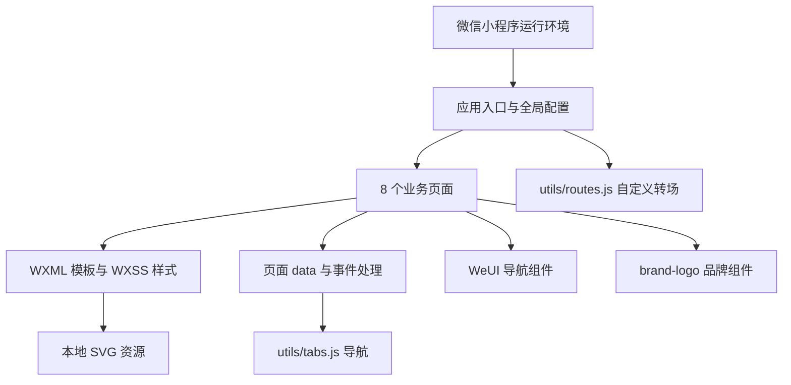
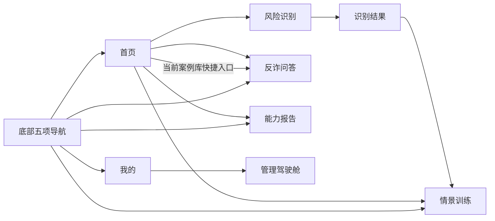
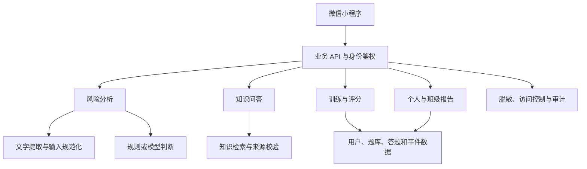

# Anti-Fraud Coach（AI 反诈教练）项目技术、架构与功能分析报告

> 报告日期：2026 年 10 月 22 日  
> 分析目录：`C:\Users\22672\Documents\CRAIC`  
> 分析方式：项目源码、配置、页面、样式和资源全量静态分析，辅以语法和文件完整性检查。

## 1. 报告口径与版本说明

本报告结合当前工作区证据与项目负责人的最新说明编写。必须区分“当前可见源码”和“项目最新修复状态”，不能把某一份工作区快照直接等同于项目所有版本。

**项目负责人已明确确认：扫描输入处理、问答和训练按钮事件、雷达图静态展示等此前指出的问题实际已经解决。** 本报告将这些事项列为“已解决（用户确认），修复实现待核对”，不再作为项目当前未解决缺陷。复核时，本目录内相关文件仍呈现原型实现，尚未取得对应修复代码，因此本报告不虚构其实现方式、接口、算法或测试结果。

全文采用三种证据口径：

- **源码确认**：可由本次实际读取的工作区文件直接证明。
- **用户确认**：由项目负责人明确提供，尚未在当前工作区验证的最新进展。
- **建议方案**：基于项目目标提出的后续建设方向，不属于既有技术事实。

本次未运行微信开发者工具、模拟器或真机，未验证线上服务、模型效果及性能。对未发现的后端或资源，仅表述为“当前目录未见”，不据此断言项目其他位置不存在。

## 2. 项目概览

项目名称为 **Anti-Fraud Coach / AI 反诈教练**，面向高校学生、辅导员及校园安全教育管理人员，以微信小程序承载反诈识别、知识咨询、情景训练、能力评估和管理统计。

README 将产品目标概括为：

```text
风险识别 → 可解释证据 → RAG 问答 → 情景训练 → 能力报告 → 管理驾驶舱
```

产品设计的重点是将一次风险判断延伸到解释、学习和复盘，而不只是返回简单风险标签。学生侧关注“这段信息为什么危险、应该如何应对、如何提高判断能力”，管理侧关注“哪些场景容易判断错误、培训是否完成、下一步应如何开展教育”。

当前可审阅代码以原生小程序前端为主，README 和工程描述仍使用 prototype / design prototype；用户已确认部分关键交互完成修复。更准确的总体判断是：**本次可见目录为原型形态的前端代码快照，项目已报告部分交互修复，整体最新完成度需结合修复版本及服务端材料确认。**

## 3. 工程规模与目录结构

### 3.1 文件统计

以下统计为生成报告前的原有业务文件，不包含 Git 内部文件、分析产生的临时文件及本报告。

| 类型 | 数量 | 用途 |
|---|---:|---|
| JavaScript | 12 | 应用、页面、组件和工具逻辑 |
| JSON | 12 | 应用、页面、组件、工程与索引配置 |
| WXML | 9 | 8 个页面和 1 个组件模板 |
| WXSS | 11 | 页面、组件及公共样式 |
| SVG | 12 | 导航图标、品牌资源、雷达图资源 |
| Markdown | 1 | README |
| **合计** | **57** | **59,107 字节，约 57.7 KiB** |

体积为源文件总大小，不是编译包体积，也不包含微信运行环境和扩展组件库。

### 3.2 目录职责

```text
CRAIC/
├── README.md                    项目定位与打开方式
├── app.js                       应用初始化和全局数据
├── app.json                     页面注册、渲染器与扩展库
├── app.wxss                     全局布局与公共样式
├── project.config.json          微信开发者工具工程配置
├── sitemap.json                 页面索引规则
├── pages/
│   ├── home/                    首页与功能入口
│   ├── detect/                  多类型风险输入及扫描界面
│   ├── result/                  风险结果、证据和行动建议
│   ├── qa/                      反诈知识问答
│   ├── training/                情景训练
│   ├── report/                  个人能力报告
│   ├── profile/                 个人中心与管理入口
│   └── admin/                   校园管理驾驶舱
├── components/brand-logo/       品牌组件
├── utils/tabs.js                底部导航配置与跳转
├── utils/routes.js              自定义路由转场
├── styles/tokens.wxss           颜色、标签与基础样式类
└── assets/
    ├── tabbar/                  10 个导航图标
    ├── logo/                    1 个品牌 SVG
    └── illustrations/           1 个雷达图 SVG
```

每个页面包含 `index.js`、`index.json`、`index.wxml` 和 `index.wxss`。当前目录未见 npm 依赖清单、锁文件、后端工程、数据库迁移、独立测试目录或 CI 配置；另有非业务的 `.codex-dir-test` 目录。

## 4. 技术栈与工程配置

| 技术 | 用途 | 证据与说明 |
|---|---|---|
| 微信原生小程序 | 应用宿主和页面生命周期 | `App()`、`Page()`、`Component()` |
| JavaScript | 数据、事件与导航 | CommonJS 模块机制；当前未见 TypeScript |
| WXML | 模板与交互结构 | 条件渲染、列表渲染、事件、插槽 |
| WXSS | 视觉样式与布局 | rpx、Flex、渐变、阴影、伪元素、关键帧动画 |
| Skyline | 配置中的渲染器 | `renderer: skyline` |
| glass-easel | 配置中的组件框架 | `componentFramework: glass-easel` |
| WeUI 扩展库 | 导航栏、底部导航 | `useExtendedLib.weui: true` |
| wx.worklet | 动画计算 | `derived` 与贝塞尔缓动 |
| wx.router | 自定义路由转场 | 注册 `afc-card` |
| SVG | 本地矢量资产 | 图标、品牌图形、报告图形 |
| 微信开发者工具配置 | 导入与编译 | `compileType: miniprogram` |

工程启用 ES6、PostCSS、增强编译及 Skyline 渲染选项，`minified` 为 `false`。应用配置按需加载组件代码 `lazyCodeLoading: requiredComponents`，并使用 `style: v2`。

`project.config.json` 中的 AppID 为 `touristappid`，小程序根目录为 `./`。当前未见固定基础库版本或明确的 WeUI 版本。配置证明使用意图，不证明所有设备和基础库组合均已兼容。

没有源码依据将本工程描述为 React、Vue、uni-app、Taro、某一具体大模型或某一云平台方案。具体模型、OCR、向量数据库或服务厂商需要从修复版本和服务端配置进一步确认。

## 5. 系统架构

### 5.1 当前可见前端架构



该结构以页面为中心，页面负责展示和状态处理，公共能力集中在导航、转场、样式和品牌组件。当前目录未体现独立请求层、业务服务层或数据持久化层。

### 5.2 应用初始化与状态

`app.js` 在 `onLaunch()` 中调用 `registerRoutes()`，`globalData` 保存品牌名和浅色主题。页面通过 `Page.data` 提供列表和状态，使用 `setData()` 更新界面。

当前快照没有发现网络请求、云函数调用、登录或本地存储 API。由此只能确认本目录未提供相应链路，不能确认用户最新修复版本采用了何种状态管理或服务连接方式。

### 5.3 页面导航

底部五项入口为“识别、问答、训练、报告、我的”。导航数据集中在 `utils/tabs.js`，页面使用 WeUI `mp-tabbar`，通过 `wx.redirectTo()` 切换。

`app.json` 没有声明原生 `tabBar`，因此当前结构是普通页面配合组件模拟底部导航。重定向可能导致页面状态重建，实际返回路径与状态保留需要结合运行测试确认。



### 5.4 路由动画

`utils/routes.js` 使用模块级变量避免重复注册，并在缺少 `wx.router` 或 `wx.worklet` 时提前返回。`afc-card` 转场组合透明度、位移与缩放，同时为背景页面设置轻微的位移、缩放和透明度变化。

调用方通过 `routeType: afc-card` 使用转场。能力判断之后的调用回退、全屏拖动和横向返回手势尚未在本次分析中运行验证。

### 5.5 业务数据流的核验边界

当前可见检测代码仍表现为类型切换、修改扫描状态、700ms 定时跳转固定结果页。用户已确认输入处理等问题解决，因此这里只记录旧快照的机制，不将其列为最新版本仍存在的问题。

修复后需要补充确认的数据链路包括：输入如何进入处理函数、结果如何传页、是否调用后端、是否保存记录、问答是否引用真实来源、训练是否更新能力数据。处理按钮可交互与已经接入真实 AI 服务是不同验收维度，不能相互推定。

## 6. 功能模块分析

### 6.1 首页

首页提供品牌介绍、安全指数、历史识别次数、本周训练进度、四类检测入口和快捷功能。

四类检测为文本、截图、链接和短信；快捷功能为 AI 问答、情景训练、能力报告和校园案例库。入口跳转逻辑在当前源码中可见，案例库入口目前指向问答页面，未见独立案例库模块。

当前快照中的安全指数 86、已识别 12 次和本周训练进度 70% 为固定展示值，不能作为实际用户数据或效果指标引用。

### 6.2 风险识别

页面采用标签切换承载文本识别、截图 OCR、链接检测与短信分析。文本和短信使用最大长度 800 的输入区，链接使用单行输入，截图采用上传区域的视觉形式。

**状态：扫描输入接入问题已解决（用户确认），最新处理实现待核对。** 当前目录仍保留模拟扫描代码，不能据此说明修复后使用了 OCR、规则模型或某一厂商 API。

该模块的业务验收应分别覆盖输入获取、空值与格式校验、图片选择、处理状态、失败反馈、结果传递，以及连续点击和退出页面时的行为。

### 6.3 风险结果

界面组织为风险等级与评分、疑似类型、置信度、风险标签、证据高亮、建议动作和参考依据。风险信号包括金钱诱导、紧迫施压、脱离平台和隐私索取。

当前快照固定展示风险分 87、置信度 92% 和“刷单返利 / 虚假兼职”，并使用“先垫付 300 元保证金”等文本作为解释样例。此类数字不应当作模型评测结果或真实概率。

当前可见按钮能进入训练页，但未传入类型或案例标识。最新版本是否已经实现按结果匹配训练，需要核对修复实现。

### 6.4 反诈知识问答

界面包含推荐问题、问答内容、风险标签、参考依据和输入发送区。回答结构为“初步判断—为什么危险—建议怎么做”，适合承载具有解释和引用的风险咨询。

**状态：问答按钮事件问题已解决（用户确认），最新事件与回答链路待核对。** 当前目录中的回答和“知识库版本 v1.0 · 已记录来源”仍为固定文案。仅有交互修复不能证明已经具备检索增强生成、真实知识来源或引用校验。

需要进一步确认的问题包括知识条目来源、检索方式、回答生成机制、会话保存方式，以及无检索结果和低可信答案的处理。

### 6.5 情景训练

六种校园场景为刷单返利、冒充客服、虚假兼职、校园贷、游戏交易、冒充熟人。界面展示等级、每日任务、场景进度和模拟选择题。

**状态：训练按钮事件问题已解决（用户确认），题目交互和评分实现待核对。** 当前可见版本保留了等级 Lv.3、每日任务 1/3 和固定场景进度。

从产品设计看，该模块适合采用“情境—选择—反馈—解析—复练”的流程。题目版本、能力标签、正确答案和评分规则应可追溯，避免训练反馈仅停留于点击效果。

### 6.6 能力报告

报告展示综合分、提升分、称号、六维能力、易错排行和学习建议。

| 维度 | 当前快照样例分数 |
|---|---:|
| 金钱诱导识别 | 86 |
| 身份核验意识 | 72 |
| 链接风险判断 | 78 |
| 隐私保护意识 | 88 |
| 证据保存意识 | 67 |
| 求助止损意识 | 74 |

**状态：雷达图静态展示问题已解决（用户确认），动态绘制实现待核对。** 当前目录仍引用固定 `ability-radar.svg`；报告不推测修复后采用 Canvas、动态 SVG 或图表库。

当前样例六项均值为 77.5，综合分显示 82。没有公式，不能认定综合分应采用均值，也不能将 82 视为已验证的算法计算结果。后续材料应明确综合评分权重、统计周期、样本量及无训练记录时的呈现。

### 6.7 个人中心

页面提供品牌说明、管理后台入口、隐私与脱敏、知识库版本和训练记录。当前快照只有管理入口具备业务跳转，其他设置项展示说明文字。

本目录未见账户身份、登录流程、设置页或数据删除机制。个人中心中的“权限控制”“案例库已同步”等文字需与实际实现分别核实。

### 6.8 管理驾驶舱

驾驶舱展示班级完成率、平均识别分、高风险案例数、本周训练量、易错类型排行和教育建议。当前快照数值分别为 78%、82、16 和 214，属于样例。

该“后台”是小程序内的普通页面，而非独立后台网站或服务端。当前目录未体现角色判断、班级选择、统计查询和导出功能。接入真实班级数据时，用户角色和组织范围应由服务端验证，不能依赖页面入口是否显示。

## 7. 已使用资源与依赖清单

### 7.1 平台和组件

| 资源 | 使用方式 | 当前状态 |
|---|---|---|
| 微信小程序平台 | 页面生命周期、组件、导航 | 核心运行平台 |
| Skyline / glass-easel | 全局配置 | 已声明，运行兼容性本次未验证 |
| WeUI | 扩展库中的导航栏与底部导航 | 已引用，未固定明确版本 |
| worklet / router | 自定义转场 | 当前源码已实现 |
| 系统字体 | 苹果系统字体、苹方、Helvetica Neue、Arial 等 | 使用字体回退栈，无本地字体文件 |
| Git | 工作目录存在版本库元数据 | 复核时项目文件为未跟踪状态，需建立明确版本基线 |

### 7.2 本地视觉资源

| 资源 | 数量与尺寸 | 用途 |
|---|---|---|
| `scan-default.svg`、`scan-active.svg` | 2 个，96×96 | 识别导航 |
| `chat-default.svg`、`chat-active.svg` | 2 个，96×96 | 问答导航 |
| `train-default.svg`、`train-active.svg` | 2 个，96×96 | 训练导航 |
| `report-default.svg`、`report-active.svg` | 2 个，96×96 | 报告导航 |
| `mine-default.svg`、`mine-active.svg` | 2 个，96×96 | 个人导航 |
| `assets/illustrations/ability-radar.svg` | 1 个，640×420 | 当前快照的雷达图资源；修复后用途待核对 |
| `assets/logo/afc-mark.svg` | 1 个，512×512 | 品牌资源，当前业务代码未见直接引用 |

页面品牌主要通过 `brand-logo` 组件以 WXML 和 WXSS 绘制，支持 `name`、`tagline`、`size`、`showName`。内部包含盾形、雷达线、彩色节点和勾形。

### 7.3 内容与数据资源

当前可见内容包括六类场景名称、少量示例话术、四类风险信号、建议动作、固定问答、六维能力数据和管理统计样例。

当前目录未提供完整案例库、知识正文、来源链接、向量索引、模型权重、提示词模板、标注数据集、效果评测集或数据库文件。界面中的“v1.0”是知识版本展示文案，不能直接认定存在对应的知识库发布版本。

用户未指定具体 AI 服务提供商，因此本报告不将任何模型、OCR、云服务或数据库厂商列为已使用资源。SVG 文件中的 W3C 地址是 XML 命名空间，不是业务请求接口。

### 7.4 来源与许可

目录未见 LICENSE、素材署名或知识内容授权清单，不能仅凭本地文件判断素材原创性或商用许可。建议为案例、图标及知识条目补充来源、授权依据、审核日期和版本记录。

## 8. 视觉设计与交互特征

| 视觉语义 | 主要色值 |
|---|---|
| 品牌主色 | `#1E63FF` |
| 深色正文与主视觉 | `#0B1F3A` |
| 页面浅色背景 | `#F5F8FF` |
| 安全与建议 | `#21C58B` |
| 警示 | `#FF9F1C` |
| 高风险 | `#FF4D4F` |

项目采用卡片、圆角、阴影、标签和进度条建立统一视觉语言，信息结构突出风险等级、解释证据和下一步行动。风险同时使用文字与颜色呈现，有助于避免仅靠颜色识别状态。

`styles/tokens.wxss` 是语义样式类集合，并非完整变量化设计令牌系统。色值、间距和卡片规则仍散落在各页面，可进一步提炼公共组件和样式。

页面采用自定义导航和 `scroll-view`，关闭页面原生滚动，并通过固定高度计算预留导航区域。小屏、字体放大、安全区、返回手势及底部导航遮挡需要实机验证。

品牌组件不同尺寸主要改变外框，内部图形仍使用固定坐标，建议检查缩放比例。首页类型图标和训练图标在当前样式中较偏占位形态，可继续提升区分度。

## 9. 应用领域与价值

### 9.1 高校安全教育

项目最直接的应用是新生教育、反诈班会、校园宣传和日常风险咨询。六类场景与高校生活较为贴近，能够围绕兼职、交易、客服与熟人冒充建立连续训练内容。

### 9.2 情景式学习

通过情境判断、即时反馈和能力维度组织学习，可将抽象反诈知识转化为具体决策练习。其价值取决于题目质量和学习反馈，不应仅用训练次数替代能力提升证明。

### 9.3 校园教育管理

班级完成率和易错类型有助于组织针对性教育。必须明确统计时间、参与人数、完成标准与易错率分母，否则不同班级或不同周期的数据不能直接比较。

### 9.4 扩展应用（分析推断）

产品模式可扩展至职业院校、社区居民和企业员工的反诈培训，但需要适配案例、语言、组织结构和能力维度。当前源码没有这些领域的专属实现。

项目应定位为风险辅助与教育工具，不能依据当前材料宣称具备交易拦截、刑事定性、银行风险决策或已验证的诈骗识别准确率。

## 10. 验证结果与待确认事项

### 10.1 本次执行的检查

| 检查 | 结果 |
|---|---|
| JavaScript 语法解析 | 12 个文件通过 |
| JSON 解析 | 12 个文件通过 |
| 注册页面文件完整性 | 8 个页面的 JS、JSON、WXML、WXSS 齐全 |
| 页面事件、数据与 API 阅读 | 已完成 |
| 样式和 SVG 资源阅读 | 已完成 |
| 用户纠正后的相关文件复核 | 已完成；当前目录仍为此前实现 |
| 微信编译与真机验收 | 未执行 |
| AI 效果、延迟、负载与业务安全测试 | 未执行；当前材料不足以开展 |

语法正确不等于小程序运行正确，尤其不能替代对 Skyline、WeUI、SVG 和手势行为的实际验证。

### 10.2 已解决事项登记

| 事项 | 项目状态 | 本次核验状态 |
|---|---|---|
| 扫描输入未接入处理 | 用户确认已解决 | 修复代码待核对 |
| 问答按钮缺少事件 | 用户确认已解决 | 修复代码待核对 |
| 训练按钮缺少事件 | 用户确认已解决 | 修复代码待核对 |
| 雷达图为静态展示 | 用户确认已解决 | 动态数据与绘制实现待核对 |

这些事项不作为当前待修复缺陷重复提出。为最终验收补齐对应代码位置和测试结果即可。

### 10.3 其他待确认项

1. 最新代码所在目录、分支和版本标识，以及当前原型快照与修复版本的关系。
2. 真实风险识别、OCR、链接检测与问答服务是否接入，其输入输出契约是什么。
3. 训练记录和能力报告是否持久化，评分与统计是否可追溯。
4. 角色、班级和数据权限是否已在服务端实施。
5. 自动脱敏、数据保留、删除和知识来源记录是否具有对应实现。
6. 扫描重复触发、定时器清理、路由回退及导航状态是否已覆盖测试。
7. 资源授权、运行版本与发布说明是否齐全。

以上是材料与验收范围的待确认事项，不等同于已经证明最新版本存在这些缺陷。

## 11. 建议的后续架构与交付路径

本节为建设建议；已有能力应在核对最新实现后复用，不应重复开发。

### 11.1 业务职责划分



图中按职责划分，不要求初期拆为微服务。可以采用单一后端服务配合清晰模块边界，在实际业务规模明确后再考虑部署拆分。

### 11.2 数据模型建议

| 数据对象 | 关键字段或口径 |
|---|---|
| 用户与组织 | 用户标识、角色、学校、班级、访问范围 |
| 识别记录 | 输入类型、脱敏摘要、风险标签、证据、版本、状态 |
| 知识条目 | 内容、来源、适用范围、审核状态、版本、更新时间 |
| 问答记录 | 问题、回答、引用、会话关联、反馈 |
| 训练题目 | 场景、题干、选项、答案、解析、能力标签、版本 |
| 作答记录 | 用户、题目版本、选择、分数、时间 |
| 能力报告 | 统计窗口、样本量、维度分、综合分、算法版本 |
| 班级指标 | 组织范围、时间窗口、参与人数、完成和错误口径 |

### 11.3 AI 与评分原则

风险识别应能够关联输入证据；OCR 失败与风险判断失败应分开表达。知识问答需要可追溯来源，检索无结果或证据不足时应有明确反馈。用户提供的聊天文本应视为待分析数据，不能改变系统任务和权限。

风险分、模型置信度、学习能力分是不同概念，需要分别定义。未建立校准依据时不应把展示百分比包装为可靠概率；能力评分应能回溯题目与作答，报告图表和数值列表应使用一致数据。

### 11.4 分阶段交付

| 阶段 | 建议目标 | 验收依据 |
|---|---|---|
| 版本对齐 | 获取并核验已修复实现 | 报告与最新源码一致 |
| 核心闭环 | 输入、判断、解释、训练、报告关联 | 一次实际操作能产生可追溯记录 |
| 知识与多输入 | 问答来源、截图提取、链接处理 | 各模块效果可独立验证 |
| 校园试点 | 角色、班级、任务和统计 | 权限边界明确，统计可复核 |
| 正式交付 | 兼容性、性能、数据流程与发布文档 | 形成可重复的验收与发布基线 |

### 11.5 新增资源和成本因素

可能需要补充审核后的案例库、题库、标注样本、效果评估集、后端和数据存储，以及按实际选型使用的 OCR、模型或检索服务。人员能力涉及小程序、后端、AI 应用、内容审核和测试。

现有材料没有用户规模、调用次数、图片处理量、模型方案或保留周期，无法可靠估算运行费用。后续可分别核算模型调用、图片处理、存储、服务托管与内容维护投入，不应以当前源码体积推算运营成本。

## 12. 运行与维护说明

README 指引使用微信开发者工具打开项目目录。工程以根目录作为小程序目录，没有现成 npm 脚本，因此不能将 `npm install` 或 `npm run dev` 描述为该项目已有的运行流程。

建议在对齐最新版本后依次验证：

1. 导入工程并核对应用身份、基础库和渲染配置。
2. 验证导航组件、品牌资源、页面滚动和图标加载。
3. 验证四类输入、结果解释、问答发送、训练选择及报告联动。
4. 验证返回路径、连续点击、离页行为、字体放大和安全区。
5. 如已连接业务服务，验证失败重试、权限边界和数据持久化。

正式维护应明确代码版本、配置项、资源来源、测试记录、发布说明及知识更新流程。当前工作区文件显示为未跟踪，建议将经过确认的源码纳入明确版本基线；本次分析没有修改业务代码或创建提交。

## 13. 综合评价

项目具有清晰的校园反诈教育定位，页面覆盖从风险输入到教学反馈的主要环节。原生小程序结构轻量，导航、品牌和视觉体系已经具备一定复用基础。解释风险依据、提供行动建议、连接情景训练和能力评估，是该产品设计的主要价值。

用户已确认扫描输入、问答与训练事件、动态雷达图相关问题解决，应将其视为项目最新进展。当前分析环境仍保留此前代码，因而本报告对具体修复实现保持待核对，不将历史快照问题重复认定为最新缺陷。

下一步最重要的是对齐版本与证据：用最新源码、服务说明和验收结果证明完整业务闭环，使技术介绍、功能展示和实际实现一致。

## 附录：关键证据索引

| 内容 | 对应文件 |
|---|---|
| 产品定位与目标流程 | `README.md` |
| 工程身份与编译配置 | `project.config.json` |
| 页面与渲染框架 | `app.json` |
| 初始化与品牌全局数据 | `app.js` |
| 导航与页面转场 | `utils/tabs.js`、`utils/routes.js` |
| 四类输入和扫描快照 | `pages/detect/index.js`、`pages/detect/index.wxml` |
| 风险解释和结果样例 | `pages/result/index.js`、`pages/result/index.wxml` |
| 问答结构 | `pages/qa/index.js`、`pages/qa/index.wxml` |
| 六类训练场景 | `pages/training/index.js`、`pages/training/index.wxml` |
| 六维能力与报告 | `pages/report/index.js`、`pages/report/index.wxml` |
| 管理入口和统计样例 | `pages/profile/index.js`、`pages/admin/index.js` |
| 品牌实现 | `components/brand-logo/` |
| 样式体系 | `app.wxss`、`styles/tokens.wxss`、页面 WXSS |
| 视觉资产 | `assets/tabbar/`、`assets/logo/`、`assets/illustrations/` |
| 已修复事项状态 | 本次对话中项目负责人的明确确认；实现文件待补充 |

本报告不使用未经核验的外部行业数据、厂商性能指标或模型准确率。技术事实来自当前工作区，最新修复状态来自用户说明，两者分别标注。
